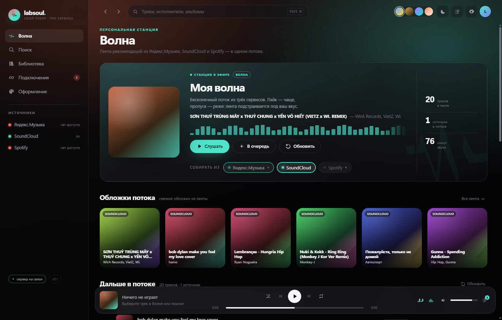

# labsoul

**Свой музыкальный плеер: Яндекс.Музыка, SoundCloud и Spotify в одном окне — с лентой рекомендаций и полностью настраиваемым видом.**



---

## Что это

labsoul — локальный десктопный плеер (и веб-версия), который собирает каталоги трёх сервисов в один
интерфейс. Он не перекрашивает чужой сайт и не прячется за обёрткой: это собственный клиент со своим
сервером, своим плеером и своим оформлением.

- **Один поиск на три каталога** — результаты сгруппированы по источнику, недоступное честно помечено.
- **Импорт по ссылке** — вставьте ссылку Spotify, Яндекс.Музыки или SoundCloud: labsoul разберёт её
  и найдёт играбельную версию в подключённых каталогах. Работает без токенов.
- **«Волна»** — лента рекомендаций. Если подключён Яндекс, работает настоящий ротор «Моя волна»
  (лайк/дизлайк/скип влияют на подбор). Без него — локальный движок: профиль вкуса из истории
  прослушивания и оценок, похожее ищется в SoundCloud. **Источники переключаются прямо в шапке
  волны** — Яндекс, SoundCloud и Spotify в любой комбинации; выбор запоминается.
- **Оформление** — пресеты (стекло, пластинка, неон, бумага, AMOLED), акцент, вычисленный из обложки,
  обои, плотность, скругления, размытие, шрифт, зерно, анимации. Тема выгружается и загружается JSON-файлом.
- **Эквалайзер** — 10 полос с пресетами, живьём, без перезапуска трека.
- **Ничего лишнего**: без телеметрии, без аккаунтов labsoul, токены сервисов лежат только у вас на диске.

## Быстрый старт

Нужен [Node.js 22+](https://nodejs.org).

```powershell
start.cmd
```

или вручную:

```powershell
node server/index.mjs
# открыть http://127.0.0.1:5270
```

### Первый запуск в приложении

1. Запустите `labsoul-0.1.0-setup.exe` (или `app\start.cmd` из исходников).
2. **SoundCloud уже работает** — откройте «Волну» или «Поиск».
3. **Подключения → «Войти в Яндекс.Музыку»** — откроется сервис, войдите как обычно:
   приложение само подхватит токен и закроет окно.
4. Spotify — по желанию (каталог и импорт ссылок): Client ID/Secret из
   [панели разработчика](https://developer.spotify.com/dashboard).

Десктопная версия (Electron):

```powershell
cd app
npm.cmd install
start.cmd
```

Сборка установщика: `npm.cmd run pack` → `app/dist/labsoul-0.1.0-setup.exe` (NSIS, ~78 МБ).
Внутрь попадают сервер и интерфейс целиком: приложение не требует Node у конечного пользователя.

Подключение источников — в разделе **Подключения**. В десктопном приложении Яндекс подключается
одной кнопкой **«Войти в Яндекс.Музыку»** (откроется окно Яндекса, токен подхватится сам), SoundCloud
работает сразу без настроек, Spotify — по желанию. Ручной способ и ссылки, где взять ключи:
[docs/TOKENS.md](docs/TOKENS.md).

## Источники: что реально работает

| Сервис | Поиск | Воспроизведение | Как подключается |
|---|---|---|---|
| **Яндекс.Музыка** | да | да, полное (mp3 / FLAC с расшифровкой) | свой OAuth-токен |
| **SoundCloud** | да | да, кроме треков Go+ | автоматически (`client_id` добывается сам) |
| **Spotify** | да | только превью, чаще недоступно | Client ID + Secret |

Spotify в сторонних плеерах полноценно играть нельзя: официальный Web API с ноября 2024 не отдаёт
даже 30-секундные превью новым приложениям. Поэтому Spotify в labsoul — источник каталога и матчинга:
трек находится, показывается рядом с версиями в Яндексе и SoundCloud и открывается в официальном клиенте.

## Как устроено

```
labsoul/
├─ server/                локальный сервер на голом Node.js, без зависимостей
│  ├─ index.mjs           HTTP, статика, JSON-API, прокси потоков с поддержкой Range
│  ├─ store.mjs           настройки, история, обратная связь (всё локально)
│  ├─ wave.mjs            движок «Волны»: ротор Яндекса → локальный фолбэк
│  ├─ doctor.mjs          диагностика источников: подключение → поиск → поток
│  └─ providers/          адаптеры сервисов с общим интерфейсом
│     ├─ yandex.mjs
│     ├─ soundcloud.mjs
│     └─ spotify.mjs
├─ web/                   интерфейс: ванильный JS + CSS-переменные (токены темы)
├─ app/                   Electron-оболочка (трей, медиа-клавиши, автосервер)
├─ tools/push-github.mjs  публикация содержимого в GitHub без git
└─ docs/TOKENS.md         где взять токены
```

Поток идёт так: `<audio>` → `/api/stream/:source/:id` → адаптер источника получает подписанную ссылку →
сервер качает апстрим, при необходимости расшифровывает (AES-128-CTR) и отдаёт с поддержкой перемотки.
Ключи и подписи никогда не покидают ваш компьютер.

Полное описание API и интерфейса провайдеров — [CONTRACT.md](CONTRACT.md).

## Обновления

Раз в сессию плеер спрашивает публичные релизы этого репозитория. Если появилась версия новее,
в подвале сайдбара вместо номера версии показывается плашка со стрелкой — клик открывает страницу
релиза. Токены для этого не нужны. Старые релизы прежнего мода игнорируются: релиз считается
нашим только при наличии установщика `labsoul-*-setup.exe`.

## Проверка и отладка

```powershell
npm.cmd test                # 4 набора: ядро/крипто/Range · разбор OAuth · живой поток через прокси · весь путь Яндекса на мок-API
node server/doctor.mjs      # что подключено и отдаёт ли поток
npm.cmd run pack            # собрать установщик (app/dist)
```

Тест Яндекса (`server/yandexmock.mjs`) поднимает локальный мок его API, который сам проверяет
HMAC-подпись запросов `get-file-info`: так протокол проверяется без реального аккаунта.
Настоящий адрес API можно подменить для своего прокси/зеркала — переменная `YANDEX_API_BASE`.

Логи: `data/server.log` (сервер) и `<userData>/logs/desktop.log` (оболочка).

## Правовая рамка

- labsoul не хранит и не раздаёт музыку: он проигрывает её так же, как официальный веб-клиент,
  из вашего браузера/аккаунта.
- Яндекс и SoundCloud используются через API веб-клиентов. Это не официальные публичные API:
  возможны изменения на стороне сервисов, а условия использования сервисов могут ограничивать
  подобные клиенты. Подписки не обходятся: качество и доступность зависят от вашего аккаунта.
- Spotify используется через официальный Web API в рамках его ограничений.
- Проект для личного использования. Ваши токены — ваша ответственность.

## Лицензия

MIT — см. [LICENSE](LICENSE). `labsoul` не связан с Яндексом, SoundCloud или Spotify.
